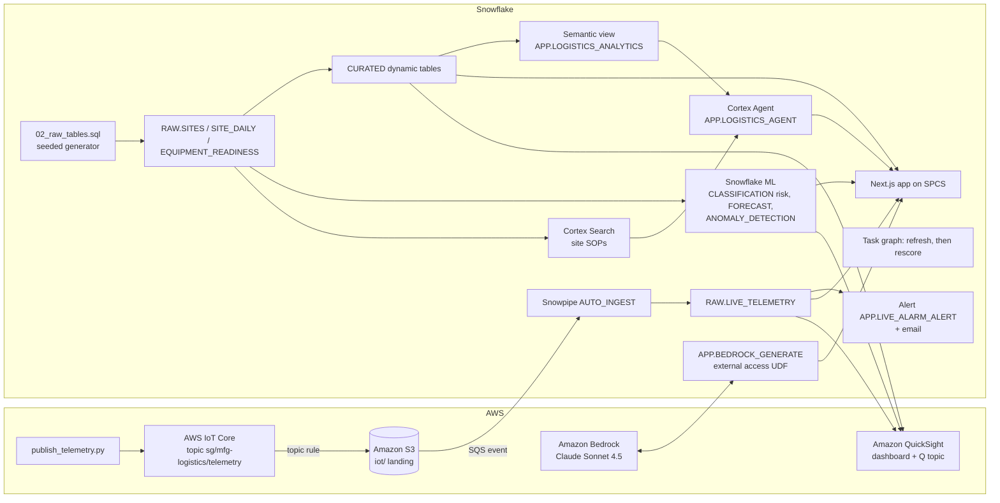

# Singapore Manufacturing Logistics Control Tower

Outbound logistics monitoring for **Kestrel Strait Industries, a fictional Singapore-based precision manufacturer, and its network of 30 logistics sites across 6 Singapore planning areas** (Tuas, Pasir Panjang, Jurong East, Woodlands, Changi, Seletar) using Snowflake, optionally with AWS: from factory dispatch docks in the western industrial estates through distribution centers and cross-docks to container yards and port terminals, with shipment traceability, a live dwell-time alarm, a 7-day disruption-risk score, an alarm email and an AI action memo.

## Architecture

A logistics control-tower pipeline built on **Snowflake** (Dynamic Tables, Snowflake ML, Cortex Search, Cortex Agent, Cortex AI_COMPLETE, SPCS) and, in the full build, **AWS** (IoT Core, S3, Bedrock Claude, QuickSight + Amazon Q). Site trackers (shipment dwell hours, handling equipment load) land in `RAW.LIVE_TELEMETRY`. Dynamic tables curate 90 days of site-day history: shipments handled, on-time shipments (within the committed delivery window), handling moves, exception moves, disruptions and equipment uptime. Snowflake ML scores 7-day disruption risk per site, forecasts network-wide shipment volume and flags shipment dwell-time anomalies. A Cortex Agent answers questions with SOP citations, and an LLM drafts the logistics action memo.

Interactive diagrams (hover for object names): [Snowflake only](docs/architecture-snowflake.html) | [AWS + Snowflake](docs/architecture-aws.html). The app shows both on its Architecture & Data tab, the current build first. Regenerate them with `python3 docs/build_architecture.py`.



The Snowflake-only build drops the AWS subgraph: `APP.SIMULATE_TELEMETRY` writes to `RAW.LIVE_TELEMETRY`, and the app calls Cortex `AI_COMPLETE` instead of the Bedrock UDF.

## Snowflake Capabilities

| Capability | Implementation |
|-----------|---------------|
| Dynamic Tables | `CURATED.KPI_SUMMARY`, `PERFORMANCE_SUMMARY`, `DISRUPTION_CAUSES`, `TREND_ANALYSIS` from the RAW tables |
| Snowflake ML | CLASSIFICATION 7-day disruption risk (`ML.DISRUPTION_RISK_SCORES`), 14-day shipment-volume FORECAST, shipment dwell-time ANOMALY_DETECTION |
| Cortex Search | 20 synthetic disruption-response SOPs (one per site type and cause) in `SEARCH.SITE_SOP_SEARCH` |
| Semantic View | `APP.LOGISTICS_ANALYTICS` over sites, planning areas, disruption causes, daily shipment flow and risk |
| Cortex Agent | `APP.LOGISTICS_AGENT`: Cortex Analyst over the semantic view plus Cortex Search for SOP citations |
| Cortex AI | `AI_COMPLETE('claude-sonnet-4-5')` for grounded answers, and for the action memo in the Snowflake-only build |
| Alerts + Tasks | `APP.LIVE_ALARM_ALERT` logs ALARM readings and sends email; task graph `TASK_REFRESH_CURATED`, then `TASK_RESCORE_RISK` |
| Snowpark Container Services | Next.js app `APP.SG_MANUFACTURING_LOGISTICS_APP` with 6 tabs: Executive Cockpit, Predictive, Site Health, Live IoT, Ask AI, Architecture & Data |
| Snowpipe | `RAW.LIVE_TELEMETRY_PIPE` AUTO_INGEST from S3 (AWS build only) |

## AWS Services

Used only in the AWS + Snowflake build.

| Service | Role in Demo |
|---------|-------------|
| AWS IoT Core | Receives simulated site tracker telemetry (shipment dwell hours, handling equipment load). A topic rule writes each message to S3 |
| Amazon S3 | Landing bucket. An event notification goes to the Snowpipe SQS queue |
| Amazon Bedrock | Claude Sonnet 4.5 writes the action memo, called from Snowflake through an external-access UDF |
| Amazon QuickSight | DIRECT_QUERY executive dashboard over Snowflake (daily on-time shipments, disruptions by site, disruption risk) |
| Amazon Q | Natural-language questions over the QuickSight topic `sg-manufacturing-logistics-topic` |
| AWS IAM | Least-privilege roles for S3, IoT and Bedrock |

## Personas

These personas and the company are fictional.

| Persona | Role | Key Questions |
|---------|------|---------------|
| **Priya Nair** | VP Singapore Logistics, Kestrel Strait Industries | "Which planning area has the lowest on-time rate?" "Which disruption causes make the most shipments late?" |
| **Marcus Lim** | Network Logistics Planner | "Which Tuas and Pasir Panjang sites are high disruption risk this week, and which SOP applies?" |

## Data

All data is synthetic and seeded, so every rebuild reproduces it. Kestrel Strait Industries, its sites and its network are fictional; the six regions are real Singapore planning areas used as labels only. No real company, carrier, port operator, checkpoint or facility is represented, and the two area-wide events (a squall berth suspension at Pasir Panjang and a checkpoint clearance outage at Woodlands) are invented.

| Table | Rows | Description |
|-------|------|-------------|
| RAW.SITES | 30 | Logistics sites across 6 planning areas and 5 site types (Factory Dispatch Dock, Distribution Center, Port Terminal, Cross-Dock, Container Yard) |
| RAW.SITE_DAILY | 2,700 | Daily site observations over 90 days: shipments, on-time shipments, order fill, handling moves, exception moves, disruptions, root cause, PM, shipment dwell hours and equipment load |
| RAW.EQUIPMENT_READINESS | 30 | Forklifts, reach trucks, quay cranes, dock doors or reach stackers required and on hand per site |
| SEARCH.SITE_SOP_DOCS | 20 | Synthetic disruption-response SOPs indexed for Cortex Search |
| RAW.LIVE_TELEMETRY | Grows during the demo | Live readings from IoT Core (AWS build) or `APP.SIMULATE_TELEMETRY` (Snowflake-only build) |
| ML.DISRUPTION_RISK_SCORES | 30 | 7-day disruption probability and risk band per site |

Shipment traceability: each site-day carries on-time shipments and the order fill rate of the shipments it handled, and every SOP asks operators to tag affected shipments with their order and container IDs. Volumes are counts of shipments and handling moves, so no currency is involved.

## Build Instructions

### Prerequisites
- Snowflake account with ACCOUNTADMIN access, and Cortex AI enabled (AI_COMPLETE, Search, Agent).
- An X-Small warehouse with auto-suspend at or below 120 s, and an existing SPCS compute pool.
- Python 3.11+, `snowflake-connector-python`, Node.js 22+, Docker and the `snow` CLI.
- App image: run `snow spcs image-registry login`, then build and push `sg-manufacturing-logistics-app:v1` to the database's `APP.IMAGES` repository (see the header of `snowflake/07_deploy_app.sql`).
- AWS build only: `boto3`, AWS credentials for the target account (us-west-2) with Bedrock access, and QuickSight Enterprise.

### SPCS App
```
<DATABASE>.APP.SG_MANUFACTURING_LOGISTICS_APP
```

### Tests
```bash
python -m pytest aws snowflake quicksight
```

For a local run, put `SNOWFLAKE_ACCOUNT`, `SNOWFLAKE_USER`, `SNOWFLAKE_DATABASE`, `SNOWFLAKE_WAREHOUSE`, `SNOWFLAKE_AUTHENTICATOR=PROGRAMMATIC_ACCESS_TOKEN`, `SNOWFLAKE_TOKEN` and `DEMO_PLATFORM` in the environment, then run `npm --prefix app run build && npm --prefix app start`.

## Build Modes

Both modes share the same core. They differ in three places, and the app's `DEMO_PLATFORM` setting (in its SPCS spec) switches the memo provider and the Live IoT tab.

| Layer | Snowflake Only | Full AWS + Snowflake |
|---|---|---|
| Live telemetry | `CALL APP.SIMULATE_TELEMETRY(n)` inserts simulated readings into `RAW.LIVE_TELEMETRY`. This simulates a tracker feed; it is not Snowpipe Streaming | `aws/publish_telemetry.py` to AWS IoT Core, then S3, SQS and Snowpipe AUTO_INGEST |
| Action memo | Cortex `AI_COMPLETE('claude-sonnet-4-5')` | Amazon Bedrock Claude Sonnet 4.5 through `APP.BEDROCK_GENERATE` |
| BI and natural-language questions | The SPCS app is the dashboard; questions go to the Cortex Agent | Also a QuickSight dashboard and an Amazon Q topic |
| App setting | `DEMO_PLATFORM: snowflake` | `DEMO_PLATFORM: aws` |

### Snowflake Only

```bash
# 1. Core data and dynamic tables (guarded: new isolated database only)
python snowflake/run_core.py --database SINGAPORE_MANUFACTURING_LOGISTICS_SNOWFLAKE --warehouse <XS_WAREHOUSE> --connection <CONNECTION> --apply
# 2. Native telemetry, ML, search, semantic view, agent, alert and task graph
python snowflake/run_intelligence.py --database SINGAPORE_MANUFACTURING_LOGISTICS_SNOWFLAKE --platform snowflake --warehouse <XS_WAREHOUSE> --connection <CONNECTION> --alert-email you@example.com
# 3. App on SPCS with DEMO_PLATFORM=snowflake (push the image first)
python snowflake/run_intelligence.py --database SINGAPORE_MANUFACTURING_LOGISTICS_SNOWFLAKE --platform snowflake --warehouse <XS_WAREHOUSE> --connection <CONNECTION> --alert-email you@example.com --files 07_deploy_app.sql --compute-pool <COMPUTE_POOL>
```

During the demo:
- Run `CALL APP.SIMULATE_TELEMETRY(20)` to add live readings. For a continuous feed, run `ALTER TASK APP.TASK_SIMULATE_TELEMETRY RESUME`, and `SUSPEND` it afterwards.
- Run `EXECUTE ALERT APP.LIVE_ALARM_ALERT` to raise the alarm email.
- Run `EXECUTE TASK APP.TASK_REFRESH_CURATED` to refresh the curated tables and rescore risk.

Afterwards, drop the database or run `ALTER SERVICE APP.SG_MANUFACTURING_LOGISTICS_APP SUSPEND`.

### Full AWS + Snowflake

```bash
# 1. Core data and dynamic tables (guarded: new isolated database only)
python snowflake/run_core.py --database SINGAPORE_MANUFACTURING_LOGISTICS_AWS --warehouse <XS_WAREHOUSE> --connection <CONNECTION> --apply
# 2. AWS ingestion and Bedrock (dry run first, then --apply)
python aws/setup_aws.py --database SINGAPORE_MANUFACTURING_LOGISTICS_AWS --account <AWS_ACCOUNT_ID> --connection <CONNECTION> --apply
# 3. ML, search, semantic view, agent, alert and task graph
python snowflake/run_intelligence.py --database SINGAPORE_MANUFACTURING_LOGISTICS_AWS --platform aws --warehouse <XS_WAREHOUSE> --connection <CONNECTION> --alert-email you@example.com
# 4. App on SPCS with DEMO_PLATFORM=aws (push the image first)
python snowflake/run_intelligence.py --database SINGAPORE_MANUFACTURING_LOGISTICS_AWS --platform aws --warehouse <XS_WAREHOUSE> --connection <CONNECTION> --alert-email you@example.com --files 07_deploy_app.sql --compute-pool <COMPUTE_POOL>
# 5. QuickSight dashboard and Q topic (needs an existing Snowflake data source)
python quicksight/build_dashboards.py --database SINGAPORE_MANUFACTURING_LOGISTICS_AWS --account <AWS_ACCOUNT_ID> --principal-arn <QUICKSIGHT_USER_ARN> --data-source-arn <DATA_SOURCE_ARN> --prefix sg-manufacturing-logistics --apply --update --with-topic
```

QuickSight objects must be shared with the QuickSight user who signs in (`--principal-arn`); otherwise the console shows nothing.

During the demo:
- Run `python aws/publish_telemetry.py --count 20` to send live readings.
- Run `EXECUTE ALERT APP.LIVE_ALARM_ALERT` to raise the alarm email.
- Run `EXECUTE TASK APP.TASK_REFRESH_CURATED` to refresh the curated tables and rescore risk.

Afterwards, `python aws/teardown_aws.py --database SINGAPORE_MANUFACTURING_LOGISTICS_AWS --account <AWS_ACCOUNT_ID> --connection <CONNECTION> --apply` removes the AWS resources and the account-level Bedrock external-access and S3 storage integrations. It leaves the email integration `SG_MANUFACTURING_LOGISTICS_EMAIL_INT`, which the Snowflake-only build also uses.

## Business Impact

Snowflake customer outcomes in logistics and equipment-heavy operations:
- **United Rentals** (Snowflake customer, manufacturing and logistics) reports "1,600+ Locations reached by the BI Agent", and its Director of Enterprise Reporting & Analytics says "Snowflake CoCo is changing everything for my team. What would take days of work can be done in minutes." -- [Snowflake customer story: United Rentals](https://www.snowflake.com/en/customers/all-customers/snapshot/united-rentals/)
- **Werner Enterprises** (transportation and logistics): "Each truck sends a location ping to the system every five minutes, which results in more than 2.5 million pings a day"; with Snowflake and CARTO, "within a few hours, Cavanaugh easily mapped out the disruption that would be caused by an interstate road closure" -- [Snowflake blog: Werner Gains Advanced Geospatial Capabilities with Snowflake and CARTO](https://www.snowflake.com/en/blog/werner-gains-advanced-geospatial-capabilities/)

## Key Demo Numbers

These figures are synthetic and come from the seeded demo data. Forecast and anomaly figures can shift slightly with the build day.

- **30 sites**, 2,700 site-days over 90 days, across 6 Singapore planning areas and 5 site types; **1,423,449 shipments** handled
- **On-time shipments 89.8%**; per-site on-time rate ranges from 85.3% to 92.8%, and Pasir Panjang is the lowest planning area at 89.1%
- **243 supply disruptions** across 14 root causes; quay crane outages make the most shipments late (5,832)
- **Disruption-risk model** out-of-time holdout: precision 0.52, recall 0.42 at a 0.5 threshold, against a 0.40 base rate (a modest lift; present it as triage). 10 sites are high risk; the top site is LG-0025, at 92.8%
- **14-day shipment-volume forecast** with prediction intervals; **60 of 480** site-days flagged as shipment dwell-time anomalies
- **Equipment uptime 98.7%**, equipment readiness 86.5%, 18.20 exception moves per 1,000 handling moves
- **20 SOPs** indexed for Cortex Search and cited by ID in agent answers

## License

Apache 2.0 — See [LICENSE](LICENSE) for details.

This is a personal demo project and is not an official Snowflake offering. It comes with no support or warranty. Industry metrics cited are from publicly available Snowflake customer stories; they represent reported outcomes and are not guarantees of results.
